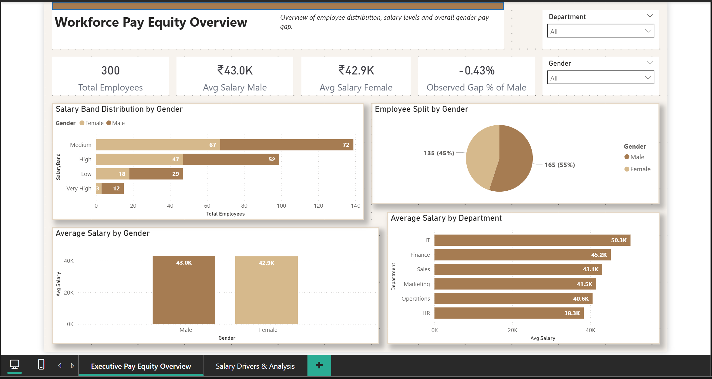

# Workforce Pay Equity Analytics (Power BI)

A Power BI dashboard and Python analysis that describe salary differences across gender, department, experience, and salary band in a **synthetic** workforce dataset of 300 employees.

> **Synthetic data disclaimer:** All records are synthetic. Observed differences describe this dataset only. They do not show discrimination or identify causes.



## Business Problem

Organisations need to understand whether pay differs between employee groups, and whether any difference is explained by factors such as experience or role. Simple averages show what the data contains. They don't show why it's there.

## Analytical Objectives

1. Describe average, median, minimum, and maximum salary by gender and department.
2. Show how salary varies with experience and salary band.
3. Make the size and direction of observed gender differences explicit, with a clear note on what they do and don't show.

## Dataset

| Item | Detail |
|---|---|
| Type | Synthetic (generated) workforce data |
| Rows | 300 employees, no duplicates or missing values |
| Columns | EmployeeID, Gender, Department, JobRole, ExperienceYears, Salary |
| Gender | Male (165), Female (135) |
| Departments | Marketing, Sales, Finance, HR, IT, Operations |
| Salary range | 28,331 to 63,463 |
| Experience range | 1 to 20 years |

### Limitations
- **Synthetic data.** Patterns reflect how the data was generated, not real workforce behaviour.
- **Small groups.** Some department-by-gender groups have 14 to 38 employees. Differences within them are unstable.
- **Binary gender only.** The dataset records Male and Female only.
- **No performance, location, or tenure detail** beyond experience years.
- **JobRole is not used in the analysis** (13 role and department combinations). Comparing pay within roles would be a useful next step, but it isn't part of this project.
- **No statistical tests.** The project reports descriptive comparisons only.

## Data Preparation

- Checked for missing values, duplicate rows, and duplicate employee IDs. None found.
- Converted Gender, Department, and JobRole to categories.
- Added **ExperienceGroup** (0-5, 6-10, 11-15, 16-20 years).
- Added **SalaryBand** (Low, Medium, High, Very High).

**Change from the original:** the original salary bands ran from 20,000 to 120,000. Actual salaries run from 28,331 to 63,463, so "Very High" had no employees and "High" had four. The bands are now 25,000 to 65,000 in 10,000 steps. The original script and file are not changed in the source folder.

## Python Analysis (`scripts/analysis.py`)

The script loads the synthetic file, checks quality, creates the two derived bands, reports average salary by gender, department, and experience group, plots a correlation heatmap and a salary boxplot by gender, and exports `cleaned_pay_equity.csv` for Power BI.

## Key Findings

All figures come from the cleaned dataset. They describe observed differences only.

- **Average salary is almost identical by gender.** Female average is 42,866 and male average is 43,049, a difference of 183 (0.4% of the male average). The median shows a similar pattern (female 42,928, male 42,380).
- **The gender difference changes direction across departments.** Female averages are higher in Finance, HR, Marketing, and Sales. Male averages are higher in IT (by about 2,900) and Operations (by about 1,200). Operations has only 14 male employees.
- **Gender differences also change direction across experience groups.** Within the 0-5 and 11-15 years groups, the female average is slightly higher. In the 6-10 and 16-20 years groups, the male average is higher, with the largest gap (about 2,500) in the 16-20 years group. These groups hold 28 to 54 employees each, so the differences are unstable.
- **Experience is strongly associated with salary.** The correlation between experience years and salary is 0.86. Average salary rises from about 35,500 (0-5 years) to about 51,700 (16-20 years).
- **Women in this dataset have slightly more experience on average.** The female average is 10.5 years and the male average is 9.8 years.

**What these findings do not show:** They do not show that pay discrimination exists or does not exist, and they do not identify the cause of any difference. Because no statistical test was run, we cannot say whether a difference is larger than chance. Controlling for role, performance, and other factors would require more data.

## Dashboard

**Power BI file:** `dashboard/workforce_pay_equity_dashboard.pbix`

**Page: Workforce Pay Equity Overview**

Shows total employees, gender split, average and minimum and maximum salary by gender, average salary by department, salary band distribution by gender, and experience vs salary at employee level.

| KPI | Definition |
|---|---|
| Total Employees | Distinct count of EmployeeID |
| Avg Salary | Average of Salary |
| Observed Gap (F-M) | Female average salary minus male average salary (descriptive only) |

## Tools and Techniques

- **Python:** pandas for cleaning and grouping, seaborn and matplotlib for the heatmap and boxplot.
- **Power BI:** data model, DAX measures, and visuals for aggregates, distributions, and a scatter plot.

## Repository Structure

```
workforce-pay-equity-analytics/
├── README.md
├── dashboard/
│   └── workforce_pay_equity_dashboard.pbix
├── data/
│   ├── pay_equity_synthetic.csv
│   └── cleaned_pay_equity.csv
├── scripts/
│   └── analysis.py
├── dax/
│   └── measures.dax
├── docs/
│   └── BUILD_GUIDE.md
└── screenshots/
    └── 01_pay_equity_overview.png
```

## How to View the Dashboard

1. Open `dashboard/workforce_pay_equity_dashboard.pbix` in Power BI Desktop.
2. If refresh shows a file error, update the source to `data/cleaned_pay_equity.csv` (Home > Transform data > Data source settings).
3. Click Refresh. Total Employees shows 300, and SalaryBand "Very High" shows 15.

## Running the Python Analysis

```
pip install pandas seaborn matplotlib
cd scripts
python analysis.py
```

The script reads `pay_equity_synthetic.csv` from the working folder, so copy it into `scripts/` first, or edit the path.

## Disclaimer

This is a portfolio project using synthetic data. Results describe the dataset only and should not be read as evidence about any real organisation.

## Author

**Sarthak Jaykar**

LinkedIn: https://www.linkedin.com/in/sarthak-jaykar

GitHub: https://github.com/sarthak-jaykar
